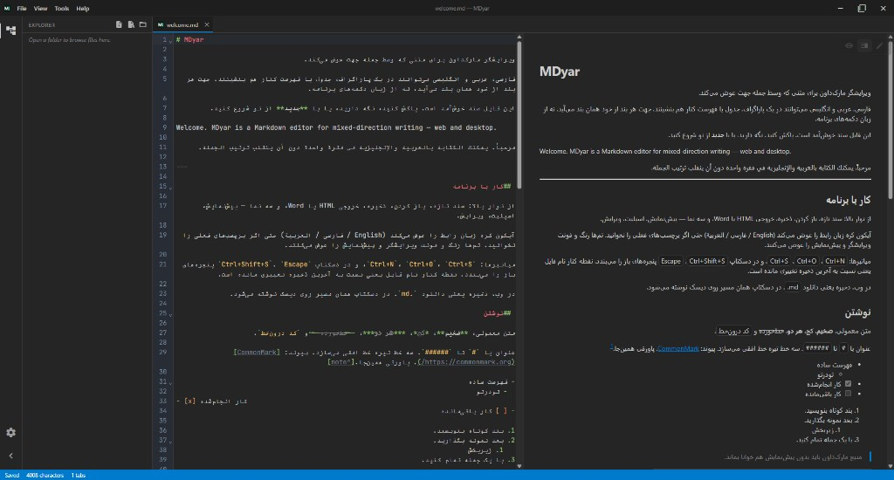

# MDyar

**محرّر Markdown ثنائي الاتجاه للويب وسطح المكتب**

اكتب الفارسية والعربية والإنجليزية ونصوصاً مختلطة في مستند واحد — يحافظ كل مقطع على الاتجاه الصحيح تلقائياً.

**الإصدار 0.6.0** · [تجربة على الويب](https://mh314k.github.io/mdyar/) · [التنزيلات](https://github.com/mh314k/mdyar/releases) · [دليل المطوّرين](docs/DEVELOPMENT.md) · **GPL-3.0-or-later**

| [English](README.md) | [فارسی](README.fa.md) | [العربية](README.ar.md) | [Русский](README.ru.md) | [中文](README.zh-CN.md) |
| --- | --- | --- | --- | --- |

---

## لماذا MDyar

معظم محرّرات Markdown مبنية لنص من اليسار إلى اليمين. **صُمّم MDyar لسير عمل ثنائي اللغة وRTL حقيقي:** فقرات وجداول وقوائم مختلطة؛ معاينة وتصدير يحترمان الاتجاه؛ مكتب مكتبي مع تبويبات وسمات واستكشاف المجلدات.

## أبرز الميزات

| | |
| --- | --- |
| **الاتجاه** | تلقائي لكل مقطع وسطر (UAX #9)؛ قفل اختياري `<!-- mdyar:dir=rtl -->` للتصدير |
| **العروض** | معاينة، تقسيم (تمرير متزامن مع رقم السطر)، تحرير |
| **Markdown غني** | GFM، KaTeX، Mermaid |
| **التصدير** | HTML مستقل وWord (.docx) |
| **السمات** | لوحات جاهزة + محرّر سمات مخصّص |
| **لغة الواجهة** | English · فارسی · العربية |
| **المنصّات** | متصفح وتطبيق أصلي (Windows، macOS، Linux) |

## احصل على MDyar

### في المتصفح

بدون تثبيت — افتح **[MDyar على GitHub Pages](https://mh314k.github.io/mdyar/)**.

افتح الملفات من جهازك؛ **الحفظ** يحمّل `.md` محدّثاً. تُخزَّن الجلسة في المتصفح.

### تطبيق سطح المكتب

حمّل أحدث إصدار من **[Releases](https://github.com/mh314k/mdyar/releases)**.

- حفظ و**حفظ باسم** على مسارات حقيقية  
- **فتح مجلد** وشجرة المشروع (ملفات MD/نص قابلة للتحرير)  
- تبويبات متعددة؛ علامة `*` على التبويب للتغييرات غير المحفوظة  
- ربط `.md` / `.markdown` / `.mdown` بعد التثبيت  
- استعادة مساحة العمل عند التشغيل التالي  

البناء من المصدر: [docs/DEVELOPMENT.md](docs/DEVELOPMENT.md).

## الويب مقابل سطح المكتب

| | الويب | سطح المكتب |
| --- | --- | --- |
| فتح ملف | منتقي المتصفح | حوار النظام |
| مجلد المشروع | — | شجرة المستكشف |
| حفظ | تنزيل | كتابة على المسار |
| حفظ باسم | — | ✓ |
| HTML / Word | تنزيل | حوار حفظ |
| نقرتان على `.md` | — | ✓ (بعد التثبيت) |

## الترخيص

برمجيات حرة تحت **[GPL-3.0-or-later](LICENSE)**. محتوى Markdown الخاص بك يبقى لك — الترخيص يغطي البرنامج لا مستنداتك.

**Copyright © 2026 MDyar contributors**
