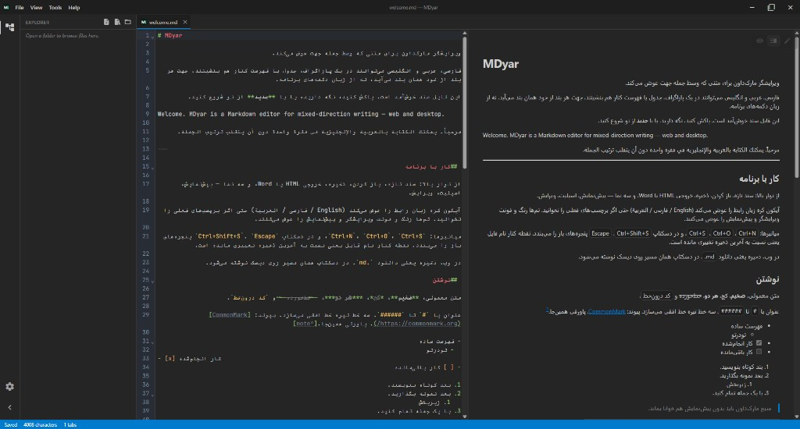

# MDyar

**ویرایشگر مارک‌داون دوجهته برای وب و دسکتاپ**

فارسی، عربی، انگلیسی و متن ترکیبی در یک سند — جهت هر بلوک به‌صورت خودکار درست می‌ماند.

**نسخه ۰٫۷٫۰** · [استفاده در مرورگر](https://mh314k.github.io/mdyar/) · [دانلود](https://github.com/mh314k/mdyar/releases) · [راهنمای توسعه‌دهندگان](docs/DEVELOPMENT.md) · **GPL-3.0-or-later**

| [English](README.md) | [فارسی](README.fa.md) | [العربية](README.ar.md) | [Русский](README.ru.md) | [中文](README.zh-CN.md) |
| --- | --- | --- | --- | --- |

---

## چرا MDyar

بیشتر ویرایشگرهای مارک‌داون برای متن چپ‌به‌راست طراحی شده‌اند. **MDyar برای کار واقعی دوزبانه و راست‌به‌چپ ساخته شده:** پاراگراف، جدول و فهرست ترکیبی؛ پیش‌نمایش و خروجی با جهت درست؛ میزکار دسکتاپ با تب، تم و مرور پوشه.

## امکانات کلیدی

| | |
| --- | --- |
| **جهت متن** | تشخیص خودکار هر بلوک و هر خط (UAX #9)؛ قفل با `<!-- mdyar:dir=rtl -->` در خروجی |
| **نماها** | پیش‌نمایش، اسپلیت (هم‌گام با شمارهٔ خط)، ویرایش |
| **مارک‌داون غنی** | GFM، فرمول KaTeX، نمودار Mermaid |
| **خروجی** | HTML مستقل و Word (.docx) |
| **تم** | پالت‌های آماده + ویرایشگر تم سفارشی |
| **زبان رابط** | English · فارسی · العربية |
| **پلتفرم** | مرورگر و برنامهٔ بومی (ویندوز، مک، لینوکس) |

## دریافت MDyar

### در مرورگر

بدون نصب — **[MDyar روی GitHub Pages](https://mh314k.github.io/mdyar/)** را باز کنید.

فایل از دستگاه انتخاب می‌شود؛ **ذخیره** فایل `.md` به‌روز را دانلود می‌کند. نشست در مرورگر نگه داشته می‌شود.

### برنامهٔ دسکتاپ

آخرین نسخه از **[Releases](https://github.com/mh314k/mdyar/releases)** (ویندوز، لینوکس، macOS).

- ذخیره و **ذخیره به‌عنوان** روی مسیر واقعی دیسک  
- **باز کردن پوشه** با درخت تنبل‌بار (فایل‌های MD/متنی قابل ویرایش)  
- عملیات فایل روی دسکتاپ: فایل/پوشه جدید، تغییر نام، حذف، کپی/برش/چسباندن (منوی راست‌کلیک + میانبر)  
- چند تب؛ نشان `*` روی تب برای ذخیره‌نشده؛ همگام‌سازی تب‌ها با جابه‌جایی یا حذف فایل  
- پسوند `.md` / `.markdown` / `.mdown` پس از نصب  
- بازیابی workspace در اجرای بعد  

ساخت از سورس: [docs/DEVELOPMENT.md](docs/DEVELOPMENT.md).

## وب در برابر دسکتاپ

| | وب | دسکتاپ |
| --- | --- | --- |
| باز کردن فایل | انتخابگر مرورگر | گفتگوی سیستم |
| پوشهٔ پروژه | انتخابگر پوشه (Chromium) | درخت اکسپلورر + عملیات فایل |
| ذخیره | دانلود | نوشتن روی مسیر |
| ذخیره به‌عنوان | — | ✓ |
| HTML / Word | دانلود | گفتگوی ذخیره |
| دوبار کلیک `.md` | — | ✓ (پس از نصب) |

## مجوز

نرم‌افزار آزاد تحت **[GPL-3.0-or-later](LICENSE)**. محتوای مارک‌داون شما مال شماست — مجوز شامل برنامه است، نه متن سند شما.

**Copyright © 2026 MDyar contributors**
