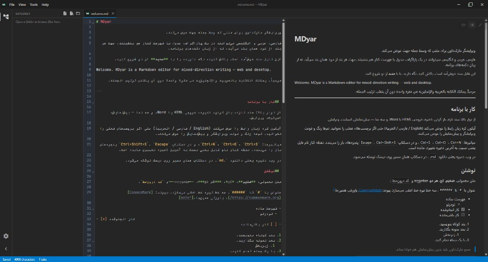

# MDyar

**Bidirectional Markdown editor for web and desktop**

Write Persian, Arabic, English, and mixed scripts in one document — each block keeps the correct direction automatically.

**Version 0.7.0** · [Try online](https://mh314k.github.io/mdyar/) · [Releases](https://github.com/mh314k/mdyar/releases) · [Developer guide](docs/DEVELOPMENT.md) · **GPL-3.0-or-later**

| [English](README.md) | [فارسی](README.fa.md) | [العربية](README.ar.md) | [Русский](README.ru.md) | [中文](README.zh-CN.md) |
| --- | --- | --- | --- | --- |

---

## Why MDyar

Most Markdown tools assume left-to-right prose. **MDyar is built for real bilingual and RTL workflows:** mixed paragraphs, tables, and lists; preview and export that respect direction; a desktop workbench with tabs, themes, and folder exploration.

## Highlights

| | |
| --- | --- |
| **Direction** | Automatic per-block and per-line direction (UAX #9); optional `<!-- mdyar:dir=rtl -->` locks for export |
| **Views** | Preview, split (scroll-synced by source line), and edit |
| **Rich Markdown** | GFM, KaTeX math, Mermaid diagrams |
| **Export** | Standalone HTML and structured Word (.docx) |
| **Themes** | Built-in palettes plus custom theme editor |
| **UI languages** | English, فارسی, العربية |
| **Platforms** | Browser app and native desktop (Windows, macOS, Linux) |

## Get MDyar

### Use in the browser

No install — open **[mdyar on GitHub Pages](https://mh314k.github.io/mdyar/)**.

Open files from your device; **Save** downloads an updated `.md`. Your session is stored in the browser.

### Desktop app

Download the latest build from **[Releases](https://github.com/mh314k/mdyar/releases)** (Windows, Linux, macOS).

- Save and **Save as** to real paths on disk  
- **Open folder** with a lazy project tree (Markdown/text editable files)  
- Explorer file ops on desktop: new file/folder, rename, delete, copy/cut/paste (context menu + shortcuts)  
- Multiple tabs, unsaved indicator (`*` on tab titles); open tabs stay in sync when files move or are deleted  
- Associate `.md` / `.markdown` / `.mdown` after installation  
- Workspace restored on next launch  

Build from source: see [docs/DEVELOPMENT.md](docs/DEVELOPMENT.md).

## Web vs desktop

| | Web | Desktop |
| --- | --- | --- |
| Open file | File picker | Native dialog |
| Project folder | Chromium folder picker | Explorer tree + file ops |
| Save | Download | Write to path |
| Save as | — | ✓ |
| HTML / Word | Download | Save dialog |
| Double-click `.md` in OS | — | ✓ (after install) |

## License

MDyar is free software under **[GPL-3.0-or-later](LICENSE)**. Your Markdown content remains yours — the license covers the program, not your documents.

**Copyright © 2026 MDyar contributors**
