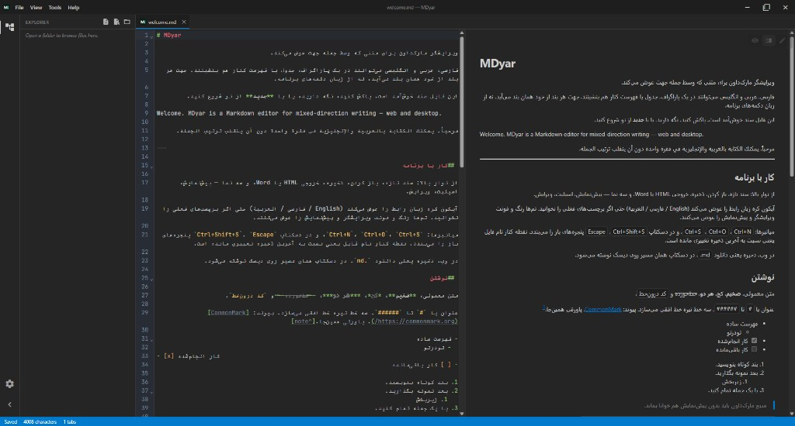

# MDyar

**Двунаправленный редактор Markdown для веба и настольных систем**

Пишите на персидском, арабском, английском и в смешанных текстах в одном документе — направление каждого блока определяется автоматически.

**Версия 0.7.0** · [Открыть в браузере](https://mh314k.github.io/mdyar/) · [Сборки](https://github.com/mh314k/mdyar/releases) · [Руководство разработчика](docs/DEVELOPMENT.md) · **GPL-3.0-or-later**

| [English](README.md) | [فارسی](README.fa.md) | [العربية](README.ar.md) | [Русский](README.ru.md) | [中文](README.zh-CN.md) |
| --- | --- | --- | --- | --- |

---

## Зачем MDyar

Большинство редакторов Markdown рассчитаны на LTR. **MDyar создан для реальной двуязычной и RTL-работы:** смешанные абзацы, таблицы и списки; предпросмотр и экспорт с корректным направлением; настольная среда с вкладками, темами и обозревателем папок.

## Ключевые возможности

| | |
| --- | --- |
| **Направление** | Авто для блока и строки (UAX #9); блокировка `<!-- mdyar:dir=rtl -->` в экспорте |
| **Режимы** | Предпросмотр, split (синхронизация прокрутки по строкам), редактирование |
| **Rich Markdown** | GFM, формулы KaTeX, диаграммы Mermaid |
| **Экспорт** | автономный HTML и Word (.docx) |
| **Темы** | встроенные палитры и редактор своих тем |
| **Язык интерфейса** | English · فارسی · العربية |
| **Платформы** | браузер и нативное приложение (Windows, macOS, Linux) |

## Как получить MDyar

### В браузере

Без установки — **[MDyar на GitHub Pages](https://mh314k.github.io/mdyar/)**.

Открытие файлов с устройства; **Сохранение** скачивает обновлённый `.md`. Сессия хранится в браузере.

### Настольное приложение

Скачайте сборку с **[Releases](https://github.com/mh314k/mdyar/releases)**.

- Сохранение и **«Сохранить как»** на диск  
- **Открыть папку** с ленивым деревом проекта (редактируемые MD/текст)  
- Файловые операции на desktop: новый файл/папка, переименование, удаление, копирование/вырезание/вставка (контекстное меню + горячие клавиши)  
- Несколько вкладок; `*` — несохранённые изменения; вкладки синхронизируются при перемещении или удалении файлов  
- Ассоциация `.md` / `.markdown` / `.mdown` после установки  
- Восстановление рабочей области при следующем запуске  

Сборка из исходников: [docs/DEVELOPMENT.md](docs/DEVELOPMENT.md).

## Веб и desktop

| | Веб | Desktop |
| --- | --- | --- |
| Открыть файл | Диалог браузера | Системный диалог |
| Папка проекта | Выбор папки (Chromium) | Дерево проводника + файловые операции |
| Сохранить | Скачивание | Запись по пути |
| Сохранить как | — | ✓ |
| HTML / Word | Скачивание | Диалог сохранения |
| Двойной щелчок по `.md` | — | ✓ (после установки) |

## Лицензия

Свободное ПО под **[GPL-3.0-or-later](LICENSE)**. Ваш Markdown остаётся вашим — лицензия относится к программе, не к содержимому документов.

**Copyright © 2026 MDyar contributors**
