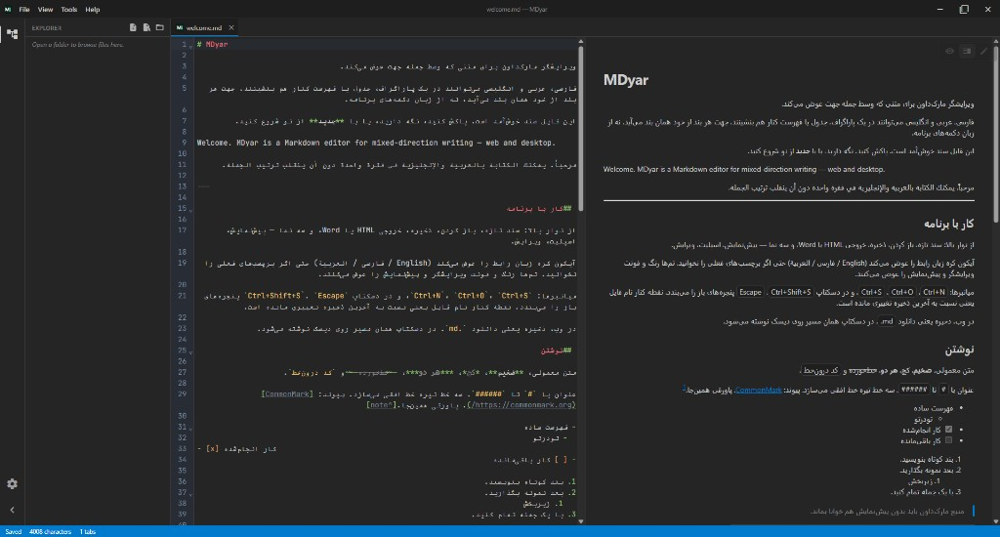

# MDyar

**双向 Markdown 编辑器 — 网页版与桌面版**

在同一文档中混排波斯语、阿拉伯语、英语等文本 — 每个块自动保持正确的书写方向。

[在线使用](https://mh314k.github.io/mdyar/) · [下载发布版](https://github.com/mh314k/mdyar/releases) · [开发者指南](docs/DEVELOPMENT.md)

| [English](README.md) | [فارسی](README.fa.md) | [العربية](README.ar.md) | [Русский](README.ru.md) | [中文](README.zh-CN.md) |
| --- | --- | --- | --- | --- |

---

## 为什么选择 MDyar

多数 Markdown 工具默认从左到右排版。**MDyar 面向真实的双语与 RTL 工作流：** 混合段落、表格与列表；预览与导出尊重文本方向；桌面工作台支持标签页、主题与文件夹浏览。

## 主要特性

| | |
| --- | --- |
| **文本方向** | 按块、按行自动检测 (UAX #9)；可用 `<!-- mdyar:dir=rtl -->` 锁定并导出 |
| **视图** | 预览、分栏（与源行号同步滚动）、编辑 |
| **丰富 Markdown** | GFM、KaTeX 公式、Mermaid 图表 |
| **导出** | 独立 HTML 与 Word (.docx) |
| **主题** | 内置配色 + 自定义主题编辑器 |
| **界面语言** | English · فارسی · العربية |
| **平台** | 浏览器与原生桌面应用（Windows、macOS、Linux） |

## 获取 MDyar

### 浏览器

无需安装 — 打开 **[GitHub Pages 上的 MDyar](https://mh314k.github.io/mdyar/)**。

从本机选择文件；**保存**会下载更新后的 `.md`。会话保存在浏览器中。

### 桌面应用

从 **[Releases](https://github.com/mh314k/mdyar/releases)** 下载最新构建。

- 保存与**另存为**写入真实磁盘路径  
- **打开文件夹**，项目树按需懒加载（可编辑 MD/文本文件）  
- 桌面端文件操作：新建文件/文件夹、重命名、删除、复制/剪切/粘贴（右键菜单 + 快捷键）  
- 多标签；未保存时标签显示 `*`；移动或删除文件时标签路径同步更新  
- 安装后可关联 `.md` / `.markdown` / `.mdown`  
- 下次启动恢复工作区  

从源码构建：见 [docs/DEVELOPMENT.md](docs/DEVELOPMENT.md)。

## 网页版与桌面版

| | 网页 | 桌面 |
| --- | --- | --- |
| 打开文件 | 浏览器选择 | 系统对话框 |
| 项目文件夹 | 文件夹选择器（Chromium） | 资源管理器树 + 文件操作 |
| 保存 | 下载 | 写入路径 |
| 另存为 | — | ✓ |
| HTML / Word | 下载 | 保存对话框 |
| 双击 `.md` | — | ✓（安装后） |

## 参与与反馈

欢迎提交缺陷报告、想法与 Pull Request。

- [新建 Issue](https://github.com/mh314k/mdyar/issues/new/choose) — 缺陷、功能建议、本地化缺口  
- 提交前请先查看 [现有 Issues](https://github.com/mh314k/mdyar/issues)  
- PR 请参阅 [docs/DEVELOPMENT.md](docs/DEVELOPMENT.md)；贡献按 **GPL-3.0-or-later** 许可

若 MDyar 对你有帮助，欢迎在 GitHub 上点一颗 [Star](https://github.com/mh314k/mdyar)。

## 许可证

自由软件，遵循 **[GPL-3.0-or-later](LICENSE)**。您的 Markdown 内容仍归您所有 — 许可证适用于程序，不适用于您的文档。

**Copyright © 2026 MDyar contributors**
